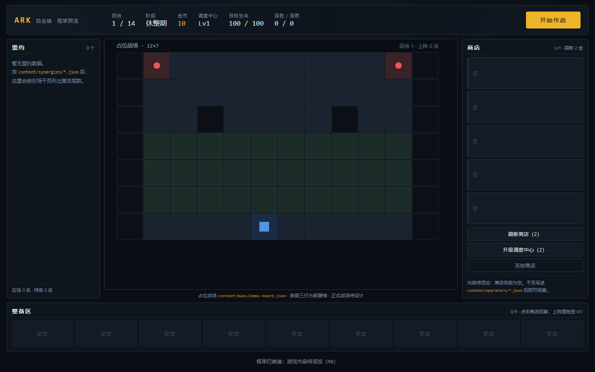
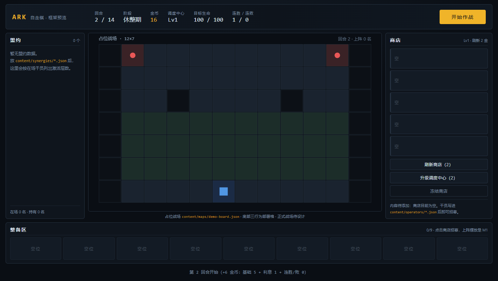

# 明日方舟风自走棋（框架阶段）

> ⚠️ **非官方同人学习项目。** 玩法参考《明日方舟》的自走棋模式「卫戍协议」、《云顶之弈》和
> 《崩坏：星穹铁道》的「货币战争」；与鹰角网络（Hypergryph/Yostar）、Riot、miHoYo 均无关联，
> 未获授权。仓库**不含任何官方素材**，版权与使用限制见 [NOTICE.md](NOTICE.md)。

一句话：**自走棋的运营 + 方舟的塔防战斗**——休整期在商店招募干员、三合一升星、凑盟约、在底部部署格
摆好朝向；作战期干员自动攻击，敌人沿路线进攻，漏过去的敌人扣目标生命；一局 14 回合。

**当前状态：M0「框架阶段」。** 能跑起来、分层清晰、数据驱动、有单测和架构守卫；
**游戏内容（干员、技能、波次、正式战场、美术）都还没做**，等设计确定后再填。

## 快速开始

```bash
cd arknights-autochess
npm install
npm run dev     # 打开 http://localhost:5173
npm run check   # 架构守卫 + 类型检查 + 单测 + 生产构建
```

要求 Node.js ≥ 22（本机验证：Node 24 / npm 11）。没有游戏内容也能启动：界面会显示占位战场和空面板。

## 预览（真实浏览器截图）

当前框架的实际界面（1440×900，`npm run build && npm run preview` 后截图，不是设计稿）：



点两次「开始作战」推进到第 2 回合：回合 2/14、金币 16（基础 5 + 利息 1）、阶段回到休整期：



## 现在能做什么 / 还不能做什么

| 已经能 | 还不能（M1+ 的内容） |
|---|---|
| 打开界面，看到 12×7 占位战场、HUD、商店/整备区/盟约面板 | 招募到真实干员、看到真实立绘 |
| 刷新/冻结商店、升级调度中心、推进回合（空数据也能走完整流程） | 真正的战斗（战斗目前是占位解算：完美防守、0 掉血） |
| 往 `content/` 加 JSON，启动时自动校验格式与引用完整性 | 摆放/拖拽交互、波次、盟约层数、装备 |
| 改规则参数（经济、等级、商店概率）不用改代码 | 联机（协议只预留了接口） |

## 目录速览

```
arknights-autochess/
├─ docs/                  设计与调研文档（先读 00-总览）
├─ content/               游戏内容数据（JSON；当前只有占位规则与占位地图）
│  ├─ config/balance.json 回合/经济/商店等规则参数
│  └─ maps/               战场（ASCII 布局 + legend）
├─ src/
│  ├─ core/               纯基础设施：网格、确定性随机、数学
│  ├─ sim/                确定性模拟：经济/商店/三合一/摆放/回合
│  ├─ content/            内容加载与校验
│  ├─ render/             PixiJS 棋盘渲染
│  ├─ ui/                 Preact 界面
│  ├─ app/                会话装配（表现层唯一的写入口）
│  └─ main.ts             浏览器入口
├─ tests/                 Vitest 单测 + 真实内容校验
├─ tools/check-layers.mjs 模块边界与确定性守卫
├─ public/assets/         可公开分发的运行时资源（当前为空）
├─ assets-src/            美术源文件（PSD/AI/AEP/Blender；当前为空）
└─ index.html / vite.config.ts / package.json
```

## 文档索引

| 文档 | 内容 |
|---|---|
| [00-总览与范围](docs/00-总览与范围.md) | 项目卡：目标、范围、风险、止损、工具版本、人机分工 |
| [01-玩法设计](docs/01-玩法设计.md) | 核心循环、运营/战斗/盟约/多人、参考对象各借鉴什么 |
| [02-技术架构](docs/02-技术架构.md) | 选型对比、分层、确定性模拟、测试策略、联机预留 |
| [03-目录结构与模块边界](docs/03-目录结构与模块边界.md) | 每个目录的职责、依赖规则、怎么加新内容 |
| [04-数据模型与Schema](docs/04-数据模型与Schema.md) | 实体字段、JSON 示例、校验规则、版本策略 |
| [05-美术音频与开源素材](docs/05-美术音频与开源素材.md) | **「有没有开源角色」的调研结论**、许可、替代方案 |
| [06-开发路线图与验收](docs/06-开发路线图与验收.md) | M0–M5 里程碑、验收标准、下次开工顺序 |
| [07-参考资料与同类项目](docs/07-参考资料与同类项目.md) | 同类开源项目/数据仓库/工具，各自许可与可借鉴点 |

## 关键决策（详见 02）

| 问题 | 当前选择 | 理由 |
|---|---|---|
| 技术栈 | TypeScript + Vite + PixiJS（棋盘）+ Preact（界面） | 浏览器即开即玩、迭代快、sim 可在 Node 跑测试；参考项目验证过同一条路 |
| 模拟层 | 纯函数、确定性（种子随机 + 固定 tick） | 可回放、可单测、以后联机可做服务端校验 |
| 内容组织 | `content/*.json` + 类型 + 启动校验 | 改内容不改代码；review 友好 |
| 代码组织 | 单包分层，暂不拆 monorepo | 现阶段开销最小；联机出现服务端再拆 `packages/sim` |
| 战斗 | M0 占位，M1 做「格挡/朝向/波次」最小闭环 | 先跑通一局，再谈深度 |

## 素材与许可

- **仓库不含官方素材**：角色立绘、Spine 模型、音乐音效、官方界面图都不进 Git。见 [NOTICE.md](NOTICE.md)。
- 「有没有开源角色」的结论：**官方角色没有可自由再分发的开源许可**；社区镜像仓库是玩家提取物，只能个人非商业研究；
  商用/公开发布请用自制美术、CC0 素材或获得授权。详细清单与替代方案见 [docs/05](docs/05-美术音频与开源素材.md)。
- 本目录代码沿用仓库根目录的 **MIT** 许可（`../LICENSE`）；第三方依赖各自保留原许可。
